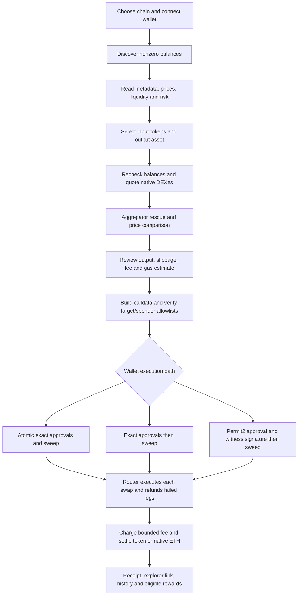

# DustSweep: existing sweep system and Optimism integration

Implementation date: 2026-10-12; follow-up audit completed 2026-10-13; deployed 2026-10-14.
Network: OP Mainnet, chain ID **10** (`0xa`).
This document records the existing flow, research decisions, implementation plan,
verification evidence, and deployment steps. The OP router and its owner allowlists
are deployed; production application activation still requires the database and release checks.

## Deployment completed, 2026-10-14

Router: [`0x54c177426033d50686ba7d36b690d1a2d7e34625`](https://optimistic.etherscan.io/address/0x54c177426033d50686ba7d36b690d1a2d7e34625#code).
Optimistic Etherscan displays **Source Code Verified — Exact Match** for
`DustSwapSweepRouterOptimism`, Solidity 0.8.24, optimizer 200, Cancun, MIT.

The user-requested MemeFun wallet `0xF113b1dBd848F44684f8543CcDf63C90f9535F57`
deployed and owns the router. Its default fee is **200 bps (2%)** and fee recipient is
**`0xE09495e955794708D4bC28045C46891cAf643733`**, as verified by on-chain getters.
The deployment transaction is
[`0x4f6cdb935ab09b0b3f24eca70128db641294016a3bd18b97a462d53e307b227e`](https://optimistic.etherscan.io/tx/0x4f6cdb935ab09b0b3f24eca70128db641294016a3bd18b97a462d53e307b227e)
at block **158199756**. All ten target/spender configuration transactions succeeded,
ending at block **158199832**. Post-deployment runtime bytecode exactly matches the
audited artifact after constructor immutables are applied; the router is unpaused
and all five Uniswap V3/V2, Velodrome V2, Kyber and LI.FI pairs are enabled.

Fresh pre-deployment verification passed **36 unit tests and nine core OP fork tests**,
with the latter at block **158199606**. Public transaction evidence, exact verification
input and constructor arguments are in `packages/contracts/deployments/optimism/2026-10-14*`.
Local API and frontend `.env.local` files now point at the deployed router, and the API
fee override is 200. Both application chain gates still list `8453,1,56`; database seed,
production app release and a connected-wallet sweep remain pending.

## Post-deployment recheck, 2026-10-14

The actual deployed router passed **six** fresh fork tests at OP block **158200380**,
with no failures or skips. These call the deployed address rather than deploying a
replacement or changing owner configuration. Real DAI, USDC and OP acquired from
forked DEX liquidity, plus WETH, settled in one native-ETH sweep. Canonical Permit2
witness/tamper/replay checks, aggregate-floor atomic rollback, a failing DAI leg's
refund while healthy legs settle, and fresh Kyber/LI.FI payloads also passed. Collector
and recipient balance changes matched the 200 bps fee; approvals ended at zero and
old router reserves were preserved. The public dependency/getter preflight also
passed at block **158200221**.

The backend now passes **34** integration regressions. Four live Hono quote/build
checks against the deployed address also passed at starting block **158200468**:
WETH to USDC, USDC to WETH, USDC+WETH to native ETH, and that basket's Permit2 build
metadata. Public RPC/providers and real public-pool balances were used; database
access alone was mocked and the transfer probe was process-disabled. This does not
establish production database readiness or a connected-wallet execution.

Fresh liquidity observations found **51** official-list assets with at least $1,000
indexed liquidity; **51/51** returned positive canonical Kyber quotes at approximately
**$1** and **$0.01**, with no provider errors. The complete official-list population
was 195 entries, of which 132 had a price hint and 63 remained unpriced. These are
current quote observations, separate from the historical 52-asset cohort below and
the six executed fork cases; they do not guarantee every token or future quote.

The recheck fixed OP execution-gas USD costs below one cent being rounded to zero,
which also suppressed cost-to-basket warnings. Base's existing gas literals and
other chains' rounding are preserved. The displayed model remains execution-gas-only;
the wallet must estimate the full OP L1/operator/execution fee.

The frontend passes **23** targeted regressions: nine receipt/results, eight chain/callback
parity and six wallet-RPC tests. The recheck fixed the shared minimum-receive display to
net the actual build's one aggregate gross floor, rather than summing every leg's quote
floor. Success output/fees now come from scoped receipt events, with executed, skipped,
refunded and failed-refund inputs distinguished; missing/malformed settlement evidence
does not become a quoted payout. Confirmed chunks combine once and legacy Base V1/V2
event formats remain supported. OKX fallback chunks also exclude initial/newly build-dropped
tokens from approvals and keep their skips in the completion summary. These local source
corrections need the application release; they are not already present in the live app.
Type-checks retain exactly the existing 52 API and four web diagnostics, with no new errors.

**Production availability is still pending.** Both the app's same-origin API and
the direct Railway API returned `400 CHAIN_NOT_ENABLED` for a quote-validation request
containing only `chainId: 10`. The reported production enabled list is
`8453,1,56,42161,4663`; the equivalent Base request passes chain resolution and reaches
required-body validation. Local gates remain `8453,1,56`. No real transaction,
production DB migration, gate change or service release was performed during this recheck.

Current evidence is under `output/optimism-postdeploy-20261014/`; detailed actual-router
settlement amounts and repeat commands are in
`output/optimism-coverage/deployed-router-smoke-2026-10-14.md`.

## Existing system, from wallet connection to settlement

The existing sweep networks are Base (8453), Ethereum (1), BNB Smart Chain (56),
Robinhood (4663), and Arbitrum One (42161). They share the same web hooks, API
handlers, and modern router ABI. Base additionally retains its legacy execution
lanes. Optimism extends the per-chain registries rather than duplicating the engine.

Current code defaults, before environment overrides:

| Network | Wrapped gas asset / stable output | Native quote sources | Route cap / minimum value |
| --- | --- | --- | --- |
| Base 8453 | WETH / USDC (6 decimals) | Existing Base ladder: Uniswap V3/V4, Aerodrome Classic/Slipstream, Pancake V3, BaseSwap, and optional Base venues | 50 / $0.01 |
| Ethereum 1 | WETH / USDC (6 decimals) | Uniswap V3, Uniswap V2, SushiSwap V2 | 15 / $1.00 |
| BNB Smart Chain 56 | WBNB / Binance-Peg USDC (18 decimals) | Pancake V3/V2, Uniswap V3, Biswap | 10 / $0.10 |
| Robinhood 4663 | WETH / USDG (6 decimals) | Uniswap V3/V4/V2 | 10 / $0.01 |
| Arbitrum 42161 | WETH / native USDC (6 decimals) | Uniswap V3, SushiSwap V2 | 10 / $0.01 |
| Optimism 10, this change | WETH / native USDC (6 decimals) | Uniswap V3/V2, Velodrome V2 | 10 / $0.01 |

BSC prices gas in BNB and must not assume six-decimal stablecoins. Robinhood's
stable output is USDG rather than USDC, and its router addresses are chain-specific.
Arbitrum keeps native USDC separate from legacy bridged USDC and uses its existing
OpenOcean launch policy. Base's deployed-router capability flag retains wallet-side
WETH unwrap behavior; the newer non-Base router deployments support router-side
passthrough. These distinctions remain in their existing chain entries.



1. **Network selection.** `apps/web/src/config/sweepChainConfig.ts` defines sweep
   networks, output assets, route caps, explorer links, and router env names.
   `NEXT_PUBLIC_DUST_SWEEP_ENABLED_CHAINS` controls which appear. The application
   wallet registry in `web3.ts` already knows Optimism, but that alone does not
   enable DustSweep there.
2. **Wallet capabilities.** `useDustSweep`, `useSweepChainSwitch`, and the wallet
   helpers probe EIP-5792 capabilities and read EIP-7702 delegation on the selected
   chain. Existing wallet-specific restrictions and fallback behavior are reused.
   Chain support does not imply every wallet can batch; the runtime capability
   result controls that decision. Coinbase paymaster support remains Base-only.
3. **Proxy.** Next.js `/api/dustsweep/*` routes forward scan, quote, build, and record
   requests to the Hono backend. Chain IDs travel with each request.
4. **Server gate.** `resolveSweepChain` resolves one `SweepChainConfig` per request
   and rejects disabled IDs with `CHAIN_NOT_ENABLED`. The default remains Base.
5. **RPC.** `apps/api/src/utils/chainRpc.ts` selects a separate keyed Alchemy pool,
   configured RPC URLs, and public fallback for each network. Base retains its
   original pool implementation. RPC rotation state is isolated by chain.
6. **Balance discovery.** The API enumerates ERC-20 balances through Alchemy,
   including pagination, and can fall back to a chain-specific Blockscout REST
   snapshot. The token whitelist supplies metadata hints; it does not restrict
   which wallet balances can appear. Optional discovery caps remain unset by
   default so large dust wallets are not silently truncated.
7. **Metadata and price enrichment.** Database hints, ERC-20 reads, DexScreener,
   Alchemy Prices, CoinGecko, and on-chain probes provide metadata and market
   information. Runtime and database caches include the chain so identical token
   addresses on different networks do not collide.
8. **Risk and selection.** The API separates swappable, hidden, suspicious, and
   unavailable balances. Spam blocks, unknown prices, and the configured minimum
   value affect selection. Native ETH is a gas balance, not an ERC-20 sweep input.
9. **Quote.** `/quote` validates amounts, checks current balances, filters output
   matches, probes native DEXes, and consults eligible aggregators according to the
   existing rescue/price-impact policy. It computes per-leg slippage floors,
   estimated totals, protocol fee, gas display, deadline, and Permit2 nonce.
10. **Build.** `/build-tx` checks the selected network, router, deadline, route cap,
    balances, transferability, and both configured and on-chain target/spender
    allowlists. It builds the current `DustSwapSweepRouter.sweep` calldata and
    returns exact approval requirements. No unlimited router allowance is needed.
11. **Authorization.** Allowance mode supports wallet batching when available and
    sequential exact approvals otherwise. Permit2 mode uses a witness binding the
    routes, output token, recipient, minimum output, deadline, and fee; its EIP-712
    domain includes the selected chain ID. The frontend follows the API's mode.
12. **Execution.** The router pulls the exact inputs, executes allowlisted swap
    legs with temporary approvals, catches swap failures independently, and refunds
    leftover input balances. It enforces the aggregate output floor and settles
    the fee and recipient output. WETH passthrough on the current router permits
    WETH to be swept into native ETH without an external swap.
13. **After execution.** The frontend waits on the selected chain, displays the
    correct explorer, and records the sweep with its chain ID. Existing quests
    accept configurable `chainIds`; cross-chain rewards retain their existing
    feature gate. Sweep campaigns remain Base-only.

## Research and implementation decisions

Use the built-in `optimism` chain from viem/wagmi, ETH for gas, and
`https://mainnet.optimism.io` as the public RPC fallback. Dedicated Alchemy OP
credentials lead the production pool. Public RPC availability does not establish
that a paid app has the OP network enabled; check its balance API before launch.

| Item | Optimism value |
| --- | --- |
| WETH | `0x4200000000000000000000000000000000000006` |
| Native Circle USDC, 6 decimals | `0x0b2C639c533813f4Aa9D7837CAf62653d097Ff85` |
| Legacy bridged USDC, separate asset | `0x7F5c764cBc14f9669B88837ca1490cCa17c31607` |
| Permit2 | `0x000000000022D473030F116dDEE9F6B43aC78BA3` |
| Uniswap V3 SwapRouter02 | `0x68b3465833fb72A70ecDF485E0e4C7bD8665Fc45` |
| Uniswap V3 QuoterV2 | `0x61fFE014bA17989E743c5F6cB21bF9697530B21e` |
| Uniswap V3 factory | `0x1F98431c8aD98523631AE4a59f267346ea31F984` |
| Uniswap V2 Router02 | `0x4A7b5Da61326A6379179b40d00F57E5bbDC962c2` |
| Uniswap V2 factory | `0x0c3c1c532F1e39EdF36BE9Fe0bE1410313E074Bf` |
| Velodrome V2 router | `0xa062aE8A9c5e11aaA026fc2670B0D65cCc8B2858` |
| Velodrome V2 factory | `0xF1046053aa5682b4F9a81b5481394DA16BE5FF5a` |

Native USDC is the stable output. Bridged USDC remains a separate sweepable asset.
Historical OP USDT and the newer, separately deployed USDT0 must likewise never
be treated as the same token. ETH is the default output, with native USDC, WETH,
and legacy USDT also available. The legacy USDT address, symbol, and six decimals
were checked against the [official Optimism token-list entry](https://raw.githubusercontent.com/ethereum-optimism/ethereum-optimism.github.io/master/data/USDT/data.json).

The native routing ladder is Uniswap V3, Uniswap V2, and Velodrome V2. Velodrome
uses Solidly routes `(from,to,stable,factory)`, compatible with the tuple shape
already used for Aerodrome Classic. The OP adapter carries its own router and
factory; it must never build a call to the Base Aerodrome router. Velodrome
Slipstream and Uniswap V4 liquidity can be reached through eligible aggregators;
their native calldata adapters are not declared supported by this integration.

The initial token cap is 10, configurable up to the existing router limit of 50.
The discovery threshold is $0.01. The backend and frontend caps match. This is an
OP-only addition; existing network settings retain their previous values.

The quote-stage gas display uses the existing execution-gas heuristic. OP's real
transaction charge also includes L1 data and operator fees. The wallet's final
estimate remains authoritative; the quote display is not a full serialized OP
transaction fee simulation.

Primary research sources:

- [OP Stack transaction fees](https://docs.optimism.io/op-stack/transactions/fees):
  execution, L1 data, and operator fee components.
- [OP Isthmus transaction derivation](https://specs.optimism.io/protocol/isthmus/derivation.html):
  EIP-7702 type-4 authorization lists.
- [Circle USDC contract addresses](https://developers.circle.com/stablecoins/usdc-contract-addresses):
  native OP USDC deployment.
- [Uniswap Optimism V3 deployments](https://developers.uniswap.org/docs/protocols/v3/deployments/v3-optimism-deployments):
  V3 factory, SwapRouter02, QuoterV2, and Permit2.
- [Uniswap V2 deployments](https://docs.uniswap.org/contracts/v2/reference/smart-contracts/v2-deployments):
  OP V2 factory and router.
- [Velodrome contracts](https://github.com/velodrome-finance/contracts):
  deployed V2 contracts and route interfaces.
- [USDT0 deployments](https://docs.usdt0.to/technical-documentation/deployments):
  the distinct USDT0 token on Optimism.

Addresses from primary documentation still require live bytecode, metadata, and
functional checks immediately before owner allowlist transactions. A documented
address, successful read-only quote, offline fixture, and fork execution are
different kinds of evidence; the validation section records which were completed.

## Build plan

1. Trace the existing implementations and compare chain-specific constants,
   discovery fallbacks, calldata builders, wallet behavior, and reward recording.
2. Verify OP assets and native router interfaces against primary documentation.
3. Add OP chain and RPC entries, discovery/pricing mappings, and target/spender
   registry. Introduce a parameterized Solidly adapter for Velodrome V2.
4. Add the sweep network, explicit build-time `_10` env reads, output assets,
   public RPC list, chain icon, and wrapping network selector layout in the web app.
5. Prepare an additive OP database seed, verification SQL, flattened Remix router,
   deployment runbook, and OP fork execution checks.
6. Verify cross-layer consistency, decoded swap/sweep calldata, Permit2 domain,
   exact approvals, rejection paths, existing wallet behavior, type checks, and
   contract execution. Keep both OP activation flags off until deployment is ready.

## Activation and rollback

Follow `packages/contracts/remix/DustSwapSweepRouter-Optimism-Deploy.md` for the
constructor, compiler settings, target/spender owner allowlists, and smoke checks.

Apply `apps/api/sql/multichain_optimism.sql`, then inspect
`apps/api/sql/multichain_optimism_verify.sql`. These are repository SQL scripts for
the existing Railway Postgres migration runner; they are not Supabase migrations.

Set the deployed OP router in both environments:

```dotenv
# API
DUST_SWEEP_ROUTER_V3_ADDRESS_10=<deployed OP router>
DUST_SWEEP_FEE_BPS_10=200
DUST_SWEEP_ROUTE_MAX_CAP_10=10
DUST_SWEEP_MIN_VALUE_USD_10=0.01
ALCHEMY_OPTIMISM_RPC_KEYS=<dedicated server-side OP keys>

# Web: rebuild after changing NEXT_PUBLIC_* values
NEXT_PUBLIC_DUST_SWEEP_ROUTER_V3_ADDRESS_10=<same deployed OP router>
NEXT_PUBLIC_DUST_SWEEP_AUTO_SELECT_LIMIT_10=10
NEXT_PUBLIC_OPTIMISM_RPC_URLS=<public browser-safe RPC URLs>
```

Additional backend settings:

| Variable | Default / purpose |
| --- | --- |
| `DUST_SWEEP_ENABLE_KYBER_10` | `true`; native-route rescue through Kyber |
| `DUST_SWEEP_ENABLE_LIFI_10` | `true`; native-route rescue through LI.FI |
| `DUST_SWEEP_ENABLE_ZEROX_10` | `false`; verify keyed swap payload before enabling |
| `DUST_SWEEP_ENABLE_OPENOCEAN_10` | `false`; verify built payload before enabling |
| `DUST_SWEEP_ALLOWED_AGGREGATOR_TARGETS_10` | Optional explicit target/spender policy; otherwise uses the chain registry |
| `DUST_SWEEP_WETH_PASSTHROUGH_10` | `true`; requires the current router artifact |
| `ALCHEMY_OPTIMISM_RPC_URLS` | Optional dedicated Alchemy URL pool |
| `OPTIMISM_RPC_URLS` | Optional server RPC URL pool |
| `OPTIMISM_RPC_PUBLIC_FALLBACK` | Existing generic RPC pool fallback switch |
| `UNISWAP_V3_SWAP_ROUTER_ADDRESS_10` | Optional verified V3 router override; update allowlists consistently |
| `UNISWAP_V3_QUOTER_ADDRESS_10` | Optional V3 quoter override |
| `UNISWAP_V3_FACTORY_ADDRESS_10` | Optional V3 factory override |
| `DUST_SWEEP_NATIVE_QUOTE_BUDGET_MS_10` | `5000`; retain completed native quotes within a bounded pool-probe window |

Blockscout REST fallback is `https://optimism.blockscout.com/api/v2`. It uses
the existing Blockscout key configuration when present; hosted Blockscout
JSON-RPC remains excluded from the OP RPC pool. The Alchemy Prices network is
`opt-mainnet`, DexScreener network is `optimism`, and CoinGecko asset platform is
`optimistic-ethereum`.

Server Alchemy keys must not be copied into `NEXT_PUBLIC_*` variables. Preserve
the existing configured chain lists and append `10` to both
`DUST_SWEEP_ENABLED_CHAIN_IDS` and `NEXT_PUBLIC_DUST_SWEEP_ENABLED_CHAINS` only
after deployment, database, provider, and transaction checks pass.

Rollback: remove `10` from both enabled-chain lists and rebuild the web app.
The additive token rows and OP router can remain in place for a later launch.

## Validation evidence

Completed across 2026-10-12 and 2026-10-13:

- **33 offline integration tests pass** in
  `apps/api/tests/optimism-integration.test.cjs`. They run the real Hono quote/build
  handlers with isolated RPC/database/HTTP fixtures, compare frontend/backend
  chain settings, independently decode swap/sweep calldata, verify exact approval
  amounts and Permit2 chain binding, exercise mixed-token quote-to-build selection
  and valid two-hop routes on all three venues, and reject invalid factory/path/
  target, duplicate input, fake passthrough, stale balance, missing allowlist and
  disabled-chain requests. Fee/slippage normalization, malformed deadline/nonce,
  aggregator kill switches, rewards chain context and a failed venue leaving
  healthy quote candidates available are covered too. Coverage regressions also
  exercise deeper direct/indirect fee-pair comparisons, unindexed native
  discovery, RPC/provider recovery, exact-amount negative caches, queued deadlines,
  executor-bound aggregator calldata and live-decimal price inference.
  Run `node --test tests/optimism-integration.test.cjs`
  from `apps/api` (or `pnpm test:optimism` with the package manager available).
- **6 existing wallet RPC regression tests pass**. Run
  `node --experimental-strip-types --test tests/dustsweep-wallet-rpc.test.mjs`
  from `apps/web`.
- **6 wallet-chain/coverage regression tests pass** in
  `apps/web/tests/dustsweep-chain-parity.test.mjs`. They execute the actual hook
  callbacks and dependency arrays across Base-to-Optimism rerenders with an
  unchanged wallet client. The OKX case sends one clean atomic approval+sweep
  request on chain `0xa`; viem, both TokenPocket paths and the quote request also
  follow the new network. Filtered discovery balances stay visible in the picker,
  and an explicit live-balance shortfall invalidates a carried route. These tests
  do not replace a real wallet smoke test.
- **9 real OP Mainnet core fork tests pass at block 158154661**, using the final
  Remix deployment artifact. Uniswap V3, Uniswap V2, Velodrome V2 and WETH-to-ETH
  passthrough settle correctly. The expanded coverage includes a
  single four-input DAI/USDC/OP/WETH sweep through three real DEXes plus passthrough
  to native ETH. It verifies one aggregate 2% fee, exact settlement and cleared
  allowances. Real canonical Permit2 signatures succeed and reject witness
  tampering and replay. An impossible aggregate output floor rolls back every
  input pull and the Permit2 nonce; a fresh valid signature can reuse that nonce.
  One failed DEX leg refunds its input while the other legs settle.
  The runbook gives the opt-in command. These tests broadcast no transactions.
- **2 real aggregator built-payload fork simulations pass at block 158154661**.
  Kyber and LI.FI return the canonical target/spender and execute through the exact
  local deployment artifact with positive output floors, realized 2% fees,
  recipient settlement and zero final DEX allowances or router holdings. Kyber
  produces 25,184,979 raw USDC; LI.FI produces 25,096,976 raw USDC, with no input
  remainder for these payloads. Earlier LI.FI payloads returned unused WETH; the
  tests account for any such refund using actual events and balance changes.
  `packages/contracts/script/VerifyOptimismAggregators.ps1` repeats fresh public
  quote/build requests and local fork execution without signing or broadcasting.
- **1 real five-token aggregator basket case passes at the same block**. All 12
  fork cases pass together with zero failures/skips. The additional case acquires
  wstETH, rETH, SNX, VELO V2 and WBTC from actual forked liquidity and executes
  all five through one sweep; details appear in the coverage section below.
- **36 router unit tests pass** with
  `forge test --match-contract '^DustSwapSweepRouterTest$' -vv`: the original 24
  regressions and 12 added reserve/refund cases. The final exact OP artifact also
  passes all 12 fork cases above with no failures or skips.
- The reusable `packages/contracts/script/VerifyOptimismDependencies.ps1`
  read-only preflight passed again at block 158133571, checking deployed dependency
  bytecode, router/factory/WETH getters, and token decimals. The flattened
  deployment artifact's logic matches the canonical source after the chain name
  and documentation are normalized; its external ABI also matches.
- **Live read-only checks pass** for native DEX quote interfaces and the returned
  Kyber/LI.FI quote targets. The public Blockscout token-balance fallback returned
  HTTP 200 with a balance array; DexScreener returned HTTP 200 with an OP pair;
  CoinGecko returned HTTP 200 and mapped chain 10 to `optimistic-ethereum`.
  The chain-10 token icon endpoint returned HTTP 200. On-chain metadata checks
  confirmed all eight seeded assets: bridged USDC reports symbol `USDC`, and
  USDT0 reports `USD₮0`; both have six decimals and separate contract addresses.
- **TypeScript introduces no new diagnostics**, compared against the original
  tracked source in an in-memory compiler overlay: API 52 before/52 after; web
  4 before/4 after. Focused checks of the new chain/RPC/Solidly files and the
  changed frontend dependency graph pass. `git diff --check` passes.
- Independent review identified sequential Solidly quote probes as a potential
  timeout multiplier. They now run concurrently, allowing the existing Multicall
  batcher to combine them. The quote-to-build integration test passes afterward.
- **4 PostgreSQL migration tests pass** in
  `apps/api/tests/optimism-migration.test.cjs`, using temporary
  [PGlite](https://pglite.dev/docs/) 0.5.9 (PostgreSQL in WebAssembly). They execute
  the repository schema and existing chain migrations, apply the OP seed twice,
  compare all other-chain rows, run the actual verification SQL, reject missing
  prerequisites and a differently named global unique index, and verify full
  transaction rollback when a seed insert fails. This uses an isolated in-memory
  database, never production credentials.

To repeat the SQL audit without adding an application dependency:

```powershell
$opAuditRuntime = Join-Path $env:TEMP 'dustsweep-op-postgres-audit'
npm install --prefix $opAuditRuntime --ignore-scripts --no-audit --no-fund --package-lock=false @electric-sql/pglite@0.5.9
$env:DUST_SWEEP_SQL_TEST_RUNTIME = $opAuditRuntime
# From apps/api:
node --test tests/optimism-migration.test.cjs
```

## Token coverage and live liquidity, 2026-10-13

The read-only audit used the current
[official Optimism token list](https://raw.githubusercontent.com/ethereum-optimism/ethereum-optimism.github.io/master/optimism.tokenlist.json),
which contained 195 unique OP ERC-20 entries. This is a defined curated population,
not every token deployed on Optimism. LI.FI and DexScreener supplied a recorded
price snapshot: 133 entries could be sized approximately in dollars, and 62 could
not. DexScreener reported at least $1,000 of liquidity in an indexed pool for 52
entries. All 52 had price data and positive Kyber routes at every tested size:

| Approximate input size | Entries queried | Positive quotes | Provider errors |
| --- | ---: | ---: | ---: |
| $0.01, liquidity-backed cohort | 52 | 52 | 0 |
| $1, all price-sized official-list entries | 133 | 101 | 0 |
| $10, liquidity-backed cohort | 52 | 52 | 0 |

The 32 priced entries without a Kyber route had no $1,000 indexed-liquidity signal
in this snapshot. That does not prove zero liquidity on every venue. The 62
unpriced entries were not assigned invented dollar amounts. Of the 101 positive
$1 quotes, 27 returned less than 0.85 USDC-equivalent against their sizing price;
all were outside the $1,000-liquidity cohort. Weak liquidity and stale or
inconsistent price references therefore remain materially different from merely
finding a positive route. These measurements do not establish a fair price or
prove execution for every quoted token.

A separate 20-asset representative basket verified bytecode and metadata at OP
block 158154170. One bridged PEPE entry lacked price data. For the other 19 assets,
both approximately $1 and $10 were checked against both public providers:
Kyber quoted 38/38, LI.FI 36/38. LI.FI rejected sETH at both sizes; Kyber quoted
it. No provider failures or unexpected target/spender/chain/native-value responses
were accepted. Quoted venues included Velodrome concentrated pools, Uniswap V4,
Curve, Balancer, Sushi and other indexed pools behind the canonical aggregators.
The official Kyber
[route/build flow](https://docs.kyberswap.com/developer-guide/aggregator-api/how-to-guides/execute-a-swap-with-the-aggregator-api.md)
separates finding a route from building and executing its calldata; the audit
keeps those evidence levels separate too.

Actual five-token execution was also verified on a local fork at block 158154661:
wstETH, Rocket Pool rETH, SNX, current VELO V2 and WBTC were purchased from real
forked liquidity, then exchanged through five real Kyber payloads in **one sweep
call**. All five legs executed, producing one aggregate settlement:
11.316901 USDC gross, 0.226338 USDC fee and 11.090563 USDC net. Exact approvals were
consumed/reset, refunds and unselected purchase remainders were accounted for, and
no basket input/output remained in the router. These payloads actually used
aggregator-mediated Uniswap V4, Velodrome concentrated liquidity and Sushi V3.
The test does not broadcast transactions or mock ERC-20 balances/DEX liquidity.

Coverage fixes from this pass:

- OP V3 compares direct pools and all configured two-hop fee pairs, including
  WETH via USDC. Native probes run together, retain completed results when another
  pool is slow and leave time for aggregator fallback.
- Native V2, Velodrome and indirect V3 routes can price unindexed wallet tokens.
  Readable/selectable metadata gets priority within the existing 60-token rescue
  budget; obvious blocked spam cannot consume it. Price inference uses live
  decimals before an unverified database hint.
- OP provider fallback/rescue probes enabled aggregators within a deadline.
  Transport, rate-limit and RPC failures remain retryable instead of being cached
  as no liquidity. Negative route keys include the exact input amount. Aggregator
  caches bind chain, executor, inputs, output, amount and slippage; obsolete queued
  work cannot start after its deadline or executor change.
- The picker displays discovery-filtered balances with reasons. An explicit
  `BALANCE_CHANGED` response removes the stale carried route, while healthy
  selected routes survive transient failures.

Discovery still enumerates provider-reported nonzero wallet balances, rather than
limiting the wallet to the eight seed hints. Existing spam, minimum-value,
transferability, selection-cap, fee and slippage rules still govern selection and
execution. Truly unindexed tokens with only aggregator liquidity can remain
`UNKNOWN_PRICE`: discovery's bounded native price rescue is not a full aggregator
pricing crawl. Missing quotes, unavailable prices, malicious token behavior,
wallet gas and changing liquidity prevent a universal coverage guarantee.

Reproduce the public quote measurement from the repository root:

```powershell
node apps/api/scripts/check-optimism-liquidity.cjs --metadata-only --output output/op-market.json
node apps/api/scripts/check-optimism-liquidity.cjs --from-metadata output/op-market.json --output output/op-routes.json
node apps/api/scripts/check-optimism-liquidity.cjs --from-metadata output/op-market.json --usd 0.01 --min-liquidity 1000 --output output/op-cent-routes.json
node apps/api/scripts/check-optimism-liquidity.cjs --from-metadata output/op-market.json --usd 10 --min-liquidity 1000 --output output/op-ten-routes.json
node packages/contracts/script/MeasureOptimismCoverage.mjs
```

Saved public-data evidence is under `output/optimism-universe-*-20261013.json`,
`output/optimism-liquid-dust-*-20261013.json` and `output/optimism-coverage/`.
`packages/contracts/script/VerifyOptimismAggregatorBasket.ps1` builds fresh
representative payloads and runs the additional real-liquidity fork case.

## Release readiness

The follow-up contract audit reproduced and fixed a shared accounting defect:
old input balances could mask fee-on-transfer under-delivery, and sender-paid
extra tax could consume old balances during a DEX call, refund or output payout.
The canonical source and newly regenerated OP artifact reserve each unique
token's pre-pull balance. Swap and refund transfers run in caught self-only
frames with post-transfer reserve checks; settlement also preserves the old
output balance. Malformed refund booleans and reverting/short balance reads no
longer undo unrelated healthy legs. An unreadable initial snapshot still fails
closed before inputs are pulled; failed refunds remain recoverable by the owner.

The wallet-facing `sweep` selector (`0xe8f410c3`), witness hashes and receipt events
are unchanged. Two additive self-only helpers avoid per-sweep storage overhead.
The corrected source is for this new OP deployment and future deployments;
existing deployed routers do not acquire these fixes automatically. All original
24 unit regressions, 12 new accounting tests and 12 OP fork cases pass.

The follow-up parity review found and corrected shared-path issues that could
affect a new chain: wallet send callbacks retaining a previous chain, old quote
responses surviving a network/output/selection change, and prior-chain wallet
capability/delegation results being used while the next probe was pending. The
UI now waits for that probe, disables network changes during execution and checks
the quote's chain before sending. Existing intentional OKX and TokenPocket batch
attempt/fallback rules remain in place.

The API rejects duplicate inputs, invalid slippage/deadline/nonce values and fake
passthrough routes, and pins OP native routes to configured routers, path
endpoints, fee tiers and factories. Quote and build use the same integer fee
bounded by the contract's 300 bps maximum. The shared aggregator kill switch also
applies on non-Base networks. Reward event metadata now includes the sweep chain.
Token-logo panels carry the selected chain through their fallback lookup and
network badge, alongside the official
[Optimism logo](https://github.com/ethereum-optimism/ethereum-optimism.github.io/blob/master/data/OP/logo.png)
and [Velodrome branding](https://velodrome.finance/svg/VELO/favicon.svg).

The local API and web environment files were checked without exposing keys.
Both enabled-chain lists currently contain `8453,1,56`; chain 10 is disabled.
Both local `.env.local` files now contain the deployed OP router address, and the API
fee override is 200. No dedicated OP RPC provider is configured locally. On 2026-10-15,
all 15 OP Railway settings were saved without triggering deployment, including adding
`10` to the existing five-chain list for the next deployment. At the user's request,
the OP Alchemy pool references the existing Base key pool; its Optimism chain ID and
token-balance API calls passed, as did the public RPC fallback. The production OP
database migration also passed with one registry row and eight seed tokens. The
API-only source upload `c10a9afc-68b8-4e43-9da6-26232a6f06a5` subsequently passed
Railway's normal build and healthcheck, enabling OP in production. Actual production
OP discovery and four quote/build cases passed with the expected router, 200 bps
fee and preserved allowance auth mode; Base remained enabled. Git publication of
the local OP changes, the matching web release and a connected-wallet sweep remain.
See `output/optimism-activation-20261015/README.md`.

One transaction means the router executes every selected token leg inside one
`sweep` call. A capable smart-account wallet can include exact approvals in that
same transaction, using the existing wallet-specific batching attempts and
fallbacks. A plain EOA with insufficient token allowance needs approval
transactions first; Permit2 also needs ERC-20 approval before its one-shot witness
signature can authorize the sweep. A chain being EIP-7702 compatible does not
guarantee that every connected wallet exposes atomic batching there.

A live code inventory at OP block 158112592 found 11 of the 13 known wallet-brand
delegate addresses deployed. The two absent addresses are secondary Uniswap
delegates (`0x0c338ca25585035142a9a0a1eeeba267256f281f` and
`0x458f5a9f47a01bea5d7a32662660559d9ed3312c`); the primary Calibur implementation
is present. These registry entries label delegation, rather than selecting a
delegate for a wallet. Live wallet capabilities and the existing foreign-delegate
guards must continue to govern execution.

An existing shared rewards limitation remains outside this OP routing change:
`POST /dustsweep/record-sweep` and the older points recorder trust client-supplied
transaction summaries; the shared points writer does not establish on-chain sweep
validity or transaction idempotency before awarding. Chain metadata is preserved,
but production reward integrity still needs receipt verification and duplicate
award protection across those entry points. The Base campaign verifier separately
verifies receipts and remains Base-only. Do not interpret passing routing tests as
proof that the existing rewards API is abuse-resistant.

Earlier API compilation reported 52 Discord, database, event decoder, points, and
S3 type diagnostics. On 2026-10-15 the full API TypeScript build passed with zero
diagnostics using the current installed dependencies; all 34 API integration tests
also passed again. The full web production build and a fresh nonincremental
TypeScript check also passed on 2026-10-15 with required filesystem/network access;
earlier admin import, font-fetch and type errors did not reproduce. Only nonblocking
dependency/lint warnings remain. The SQL seed passed isolated PostgreSQL execution
tests and was applied to production on 2026-10-15; production verification passed
and other chains' token
counts were unchanged. The contract and ten owner configuration transactions were
completed on 2026-10-14 and source verification succeeded on Optimistic Etherscan.
Railway variables are applied by the successful API source release on 2026-10-15;
four actual production quote/build cases and OP discovery passed. No frontend
production release or live wallet sweep has been performed. Full user-facing
activation still requires the web release and connected-wallet checks above.
